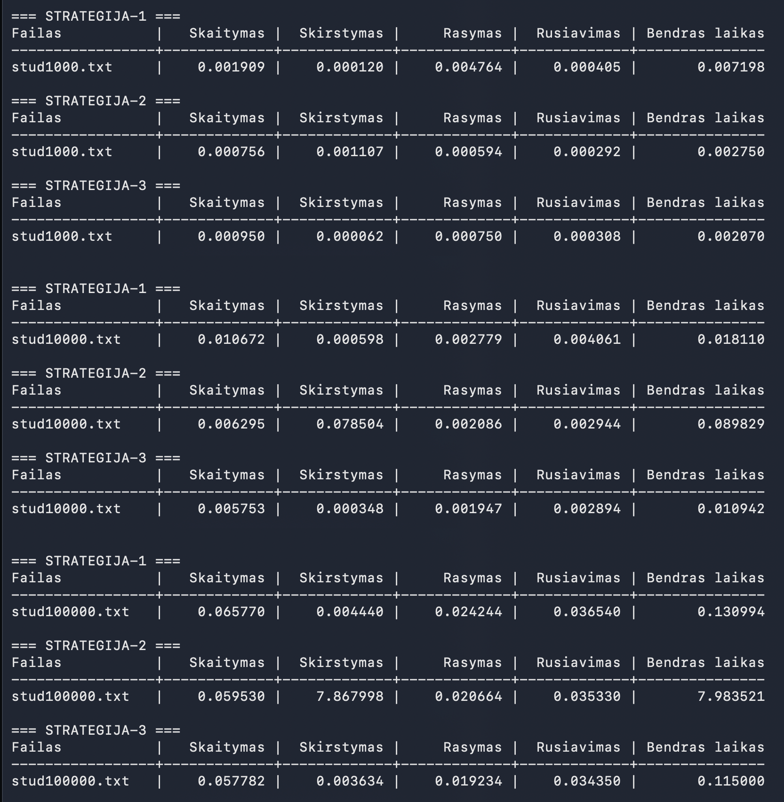
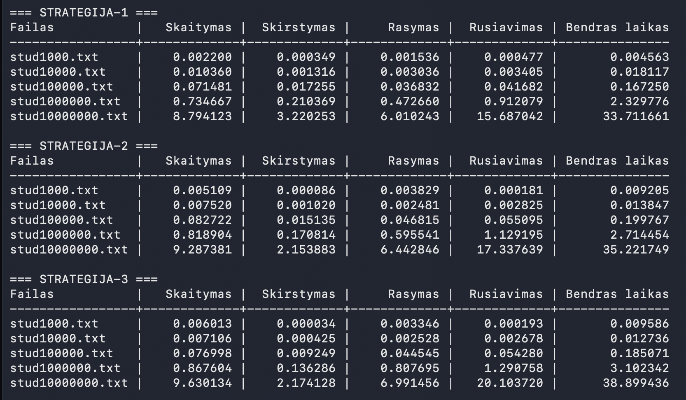
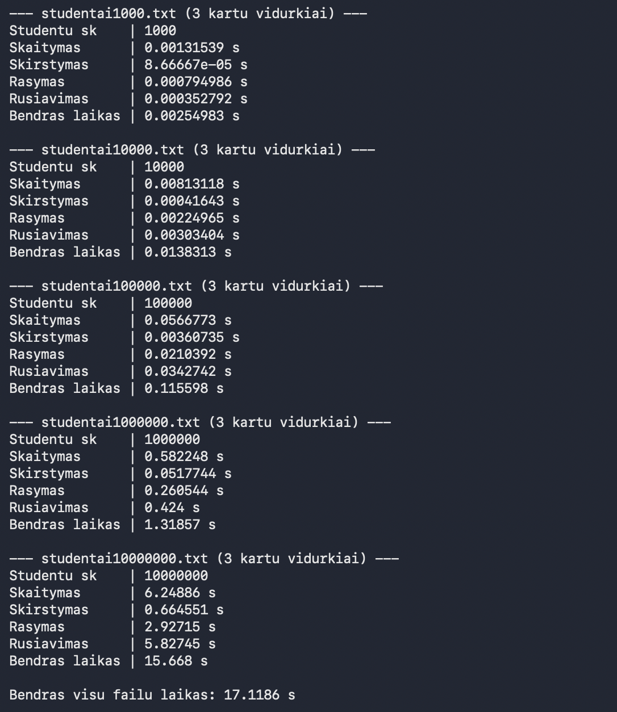
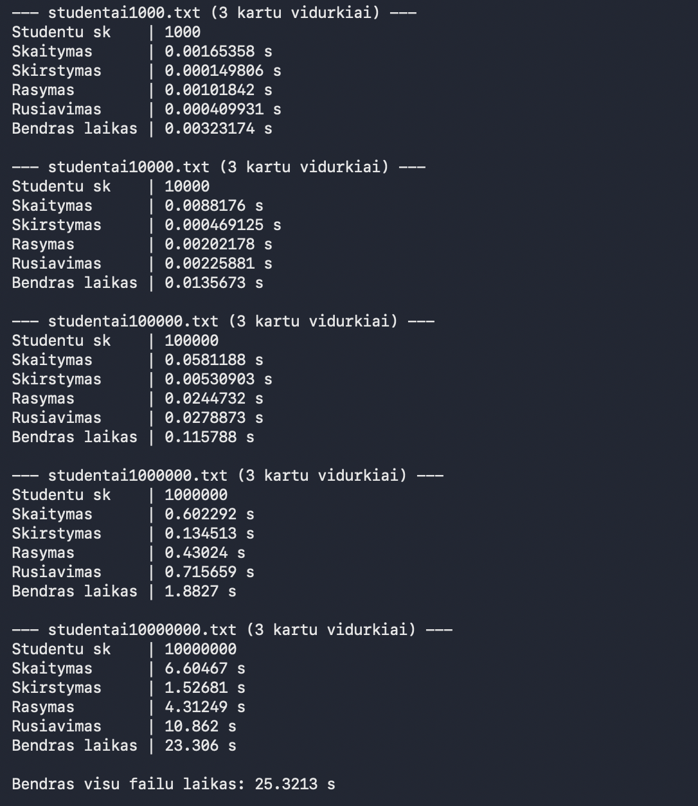

# objektinis-programavimas
  

VU objektinio programavimo projektas. Programa skaičiuoja studentų galutinius balus (pagal vidurkį arba medianą), skirsto juos į **vargšiukus** (galutinis < 5) ir **kietiakus** (galutinis ≥ 5), generuoja didelius testinius failus ir matuoja programos greitį su `std::vector` ir `std::list`.

## Funkcionalumas
- Studentų duomenų įvedimas ranka arba atsitiktinis pažymių generavimas;
- Duomenų nuskaitymas iš failo (pvz. `kursiokai.txt`);
- Galutinio balo skaičiavimas pagal vidurkį, medianą arba abu;
- Rikiavimas pagal vardą, pavardę arba galutinį balą (didėjančiai / mažėjančiai);
- Rezultatų išvedimas į ekraną arba į failą;
- Skirstymas į vargšiukus ir kietiakus trimis strategijomis;
- Testinių failų generavimas (1,000 – 10,000,000 studentų);
- Greičio analizė su viena arba visomis strategijomis;
- Konteinerio pasirinkimas programos pradžioje: `std::vector` arba `std::list`.

## Diegimas ir paleidimas

Reikia: C++17 kompiliatoriaus (`g++` arba `clang++`) ir `make`.

```bash
git clone https://github.com/mantasjeznas/objektinis-programavimas.git
cd objektinis-programavimas
make
./programa
```

Išvalyti sukompiliuotus failus:
```bash
make clean
```

Be `make` galima kompiliuoti ir ranka:
```bash
g++ -std=c++17 -O2 *.cpp -o programa
```

## Naudojimas

Paleidus programą pirmiausia pasirenkamas konteineris:
```
1 - vector
2 - list
```

Tada atidaromas pagrindinis meniu:

| Nr. | Veiksmas | Aprašymas |
|---|---|---|
| 1 | Pažymių įvedimas | Studentų vardai, pavardės, namų darbų ir egzamino pažymiai (ranka arba atsitiktinai) |
| 2 | Rodyti rezultatus | Galutinis balas pagal vidurkį / medianą / abu, į ekraną arba į failą |
| 3 | Skirstymas pagal balą | Skirstymas viena iš 3 strategijų ir grupių įrašymas į `vargsiukai.txt` ir `kietiakai.txt` |
| 4 | Nuskaityti duomenis iš failo | Studentų sąrašas nuskaitomas iš nurodyto failo |
| 5 | Failų generavimas | Sugeneruojami `stud1000.txt` – `stud10000000.txt` |
| 6 | Greičio analizė | Matuojami skaitymo, skirstymo, rašymo ir rūšiavimo laikai |
| 0 | Išeiti | Uždaryti programą |

Įvesties failo formatas:
```
Pavarde     Vardas         ND1 ND2 ND3 ... Egzaminas
Pavarde1    Vardas1        8   9   10  ... 9
```

## Failų struktūra

| Failas | Paskirtis |
|---|---|
| `main.cpp` | Konteinerio pasirinkimas ir programos paleidimas |
| `Meniu.h` | Pagrindinis meniu (`programa()`) |
| `Studentas.h` | Studento struktūra, galutinio balo skaičiavimas, skirstymo strategijos |
| `Failai.h`, `Failai.cpp` | Failų skaitymas, rašymas, generavimas ir greičio analizė |
| `Pagalbiniai.h`, `Pagalbiniai.cpp` | Įvesties tikrinimas ir pagalbinės funkcijos |
| `Makefile` | Kompiliavimo taisyklės |

## Galutinio balo formulė

$$
Galutinis = 0.4 \cdot ND + 0.6 \cdot Egz.
$$

kur ND yra namų darbų vidurkis arba mediana.

## Skirstymo strategijos

| Strategija | Kaip veikia | Atmintis | Greitis `vector` | Greitis `list` |
|---|---|---|---|---|
| 1 | Studentai kopijuojami į du naujus konteinerius `vargsiukai` ir `kietiakai`, pradinis lieka | Daugiausia (duomenys du kartus) | Greita, O(n) | Greita, O(n) |
| 2 | Vargšiukai perkeliami į `vargsiukai` ir ištrinami iš pradinio, jame lieka kietiakai | Mažiau | Lėta, O(n²) | Greita, O(n) |
| 3 | `vector`: `stable_partition`, `copy` ir vienas `erase`. `list`: perkėlimas su `splice` | Mažiausia | Greita | Greita |

## v1.0 greičio rezultatai

Testuota su sugeneruotais failais `stud1000.txt` – `stud10000000.txt`. Kiekvienas matavimas kartotas **3 kartus**, lentelėse pateikti vidurkiai. Failų generavimas į laiką neįtrauktas.

Etapai:
- **Skaitymas:** failas nuskaitomas į konteinerį
- **Skirstymas:** studentai suskirstomi pasirinkta strategija
- **Rašymas:** grupės surašomos į `vargsiukai.txt` ir `kietiakai.txt`
- **Rūšiavimas:** grupės surikiuojamos pagal galutinį balą

Kompiliuota su `-O2` (`make`).

### `std::vector`

#### 1 strategija: kopijavimas į du naujus konteinerius

| Failas | Skaitymas, s | Skirstymas, s | Rašymas, s | Rūšiavimas, s | Bendras laikas, s |
|---|---:|---:|---:|---:|---:|
| stud1000.txt | 0.00166236 | 0.000128486 | 0.00141181 | 0.000495153 | 0.00369781 |
| stud10000.txt | 0.00853769 | 0.000647389 | 0.00332496 | 0.0040701 | 0.0165801 |
| stud100000.txt | 0.0590816 | 0.00410125 | 0.0221474 | 0.0352927 | 0.120623 |
| stud1000000.txt | 0.600851 | 0.0583466 | 0.286208 | 0.438094 | 1.3835 |
| stud10000000.txt | 7.02892 | 0.814064 | 3.06168 | 6.32382 | 17.2285 |

#### 2 strategija: perkėlimas ir ištrynimas iš pradinio

| Failas | Skaitymas, s | Skirstymas, s | Rašymas, s | Rūšiavimas, s | Bendras laikas, s |
|---|---:|---:|---:|---:|---:|
| stud1000.txt | 0.00160661 | 0.00100056 | 0.000603027 | 0.000232236 | 0.00344243 |
| stud10000.txt | 0.00897553 | 0.0820286 | 0.00207 | 0.00294568 | 0.0960198 |
| stud100000.txt | 0.0658027 | 7.89967 | 0.0199381 | 0.0349212 | 8.02033 |
| stud1000000.txt | netestuota\* | netestuota\* | netestuota\* | netestuota\* | netestuota\* |
| stud10000000.txt | netestuota\* | netestuota\* | netestuota\* | netestuota\* | netestuota\* |

\* Netestuota, nes `erase` iš `vector` vidurio perstumia visus tolesnius elementus (O(n²)): 100 000 studentų jau užtrunka apie 8 s, todėl 1 000 000 ir 10 000 000 užtrunka labai ilgai.

#### 3 strategija: `stable_partition` + vienas `erase`

| Failas | Skaitymas, s | Skirstymas, s | Rašymas, s | Rūšiavimas, s | Bendras laikas, s |
|---|---:|---:|---:|---:|---:|
| stud1000.txt | 0.0019156 | 0.0000686113 | 0.000755125 | 0.000319944 | 0.00305928 |
| stud10000.txt | 0.00734597 | 0.000399334 | 0.00228926 | 0.00333069 | 0.0133653 |
| stud100000.txt | 0.0621963 | 0.00431856 | 0.0241329 | 0.0370303 | 0.127678 |
| stud1000000.txt | 0.621766 | 0.0473635 | 0.298968 | 0.45158 | 1.41968 |
| stud10000000.txt | 6.83245 | 1.05131 | 3.19419 | 5.74443 | 16.8224 |

<details>
<summary>VECTOR NUOTRAUKA</summary>



<b>Pavyzdinis</b> paleidimas, laikai gali šiek tiek <b>skirtis</b> nuo lentelėse pateiktų vidurkių.
</details>

### `std::list`

#### 1 strategija: kopijavimas į du naujus konteinerius

| Failas | Skaitymas, s | Skirstymas, s | Rašymas, s | Rūšiavimas, s | Bendras laikas, s |
|---|---:|---:|---:|---:|---:|
| stud1000.txt | 0.00250989 | 0.000162028 | 0.000584611 | 0.000216819 | 0.00347335 |
| stud10000.txt | 0.00821425 | 0.00128315 | 0.00264278 | 0.00306733 | 0.0152075 |
| stud100000.txt | 0.0729754 | 0.0184745 | 0.0476881 | 0.0496302 | 0.188768 |
| stud1000000.txt | 0.730854 | 0.215097 | 0.502551 | 0.967457 | 2.41596 |
| stud10000000.txt | 8.59808 | 3.35207 | 5.75018 | 15.9527 | 33.6531 |

#### 2 strategija: perkėlimas ir ištrynimas iš pradinio

| Failas | Skaitymas, s | Skirstymas, s | Rašymas, s | Rūšiavimas, s | Bendras laikas, s |
|---|---:|---:|---:|---:|---:|
| stud1000.txt | 0.00455385 | 0.00168822 | 0.00363021 | 0.000195639 | 0.0100679 |
| stud10000.txt | 0.00753026 | 0.000903403 | 0.0027271 | 0.00269275 | 0.0138535 |
| stud100000.txt | 0.076625 | 0.0139822 | 0.0456875 | 0.0484222 | 0.184717 |
| stud1000000.txt | 0.790967 | 0.164971 | 0.586792 | 0.97368 | 2.51641 |
| stud10000000.txt | 9.2135 | 2.71603 | 6.3762 | 16.5684 | 34.8741 |

#### 3 strategija: perkėlimas su `splice`

| Failas | Skaitymas, s | Skirstymas, s | Rašymas, s | Rūšiavimas, s | Bendras laikas, s |
|---|---:|---:|---:|---:|---:|
| stud1000.txt | 0.0046824 | 0.0000328193 | 0.00362018 | 0.000182375 | 0.00851778 |
| stud10000.txt | 0.00721651 | 0.000414472 | 0.00288299 | 0.00281499 | 0.013329 |
| stud100000.txt | 0.0768458 | 0.00836858 | 0.0425281 | 0.0474834 | 0.175226 |
| stud1000000.txt | 0.796779 | 0.112994 | 0.574513 | 1.14597 | 2.63025 |
| stud10000000.txt | 9.98341 | 1.71177 | 7.24059 | 18.2413 | 37.177 |

<details>
<summary>LIST NUOTRAUKA</summary>



<b>Pavyzdinis</b> paleidimas, laikai gali šiek tiek <b>skirtis</b> nuo lentelėse pateiktų vidurkių.
</details>

### Išvados

- **`vector` 2 strategija** yra lėčiausia: kiekvienas `erase` perstumia visus tolesnius elementus, todėl skirstymo laikas auga kvadratiškai. Su 10 000 studentų skirstymas trunka 0.082 s, su 100 000 jau 7.9 s (apie 100 kartų ilgiau). Todėl 1 000 000 ir 10 000 000 įrašų failai su ja netestuoti.
- **`vector` 3 strategija** (`stable_partition` + vienas `erase`) ištaiso 2 strategijos problemą: 100 000 studentų suskirstomi per 0.0043 s, t. y. apie 1800 kartų greičiau nei 2 strategija. Su 1 000 000 ji šiek tiek greitesnė už 1 strategiją (0.047 s ir 0.058 s), su 10 000 000 šiek tiek lėtesnė (1.05 s ir 0.81 s), bet naudoja mažiau atminties, nes studentai nelaikomi du kartus.
- **`list`** su 2 strategija veikia greitai, nes trynimas iš sąrašo yra O(1). Su 10 000 000 studentų skirstymas: 1 strategija 3.35 s, 2 strategija 2.72 s, 3 strategija (`splice`) 1.71 s, tad greičiausia yra 3 strategija.
- **`vector` prieš `list`:** skaitymas, rašymas ir ypač rūšiavimas su `vector` greitesni. Su 10 000 000 studentų ir 1 strategija bendras laikas su `vector` yra 17.2 s, su `list` 33.7 s, o rūšiavimas atitinkamai 6.3 s ir 16.0 s.
- **Apibendrinant:** greičiausias variantas yra `vector` su 1 arba 3 strategija. Jei svarbi atmintis, geriausia 3 strategija. 2 strategija tinka tik `list` konteineriui.

## Testavimo sistemos parametrai

- **CPU:** Apple M1 Pro
- **RAM:** 16 GB
- **Disk:** SSD

## Release'ų istorija

### [v1.0](https://github.com/mantasjeznas/objektinis-programavimas/tree/v1.0)
- Skirstymas iškeltas į atskiras funkcijas, pridėtos 3 skirstymo strategijos `vector` ir `list` konteineriams
- Strategijos pasirinkimas skirstymo meniu ir greičio analizėje
- Greičio analizėje galima paleisti visas 3 strategijas su tais pačiais failais, rezultatai išvedami lentelėmis
- Meniu iškeltas į `Meniu.h`, failai pervadinti į `stud*.txt`, kodas supaprastintas
- Pridėtas `Makefile`

### [v0.3](https://github.com/mantasjeznas/objektinis-programavimas/tree/v0.3)
- Konteinerio (`vector` / `list`) pasirinkimas programos pradžioje
- Šablonai (`template`) rikiavimui, išvedimui ir pažymiams
- Objekto adreso spausdinimas įvedus studentą
- Greičio analizė su pasirinktu konteineriu, atskiras rūšiavimo laikas

<details>
<summary>v0.3 greičio rezultatai</summary>

#### \<vector\>
| failas | studentų | skaitymas, s | skirstymas, s | rašymas, s | rūšiavimas, s | bendras laikas s |
|---|---:|---:|---:|---:|---:|---:|
| stud1000.txt | 1000 | 0.0019629 | 0.0001115 | 0.0012659 | 0.0005125 | 0.0038528 |
| stud10000.txt | 10000 | 0.0100717 | 0.0005161 | 0.0023294 | 0.0037051 | 0.0166223 |
| stud100000.txt | 100000 | 0.058124 | 0.0037096 | 0.0204477 | 0.034671 | 0.116952 |
| stud1000000.txt | 1000000 | 0.592253 | 0.0546006 | 0.279484 | 0.440726 | 1.36706 |
| stud10000000.txt | 10000000 | 6.49013 | 0.629851 | 2.99189 | 5.94023 | 16.0521 |

Bendras visų failų laikas 17,5566 s


<br>

**Išvada**. Kuo didesnis failas, tuo ilgiau trunka visi etapai. Nuo 1 000 000 iki 10 000 000 studentų kiekvienas etapas išauga maždaug 11–14 kartų. Mažuose failuose ilgiausiai trunka skaitymas. Faile su 10 000 000 studentų skaitymas (6,49 s) ir rūšiavimas (5,94 s) užima daugiausiai laiko, rašymas trunka 2,99 s, o trumpiausiai trunka skirstymas (0,63 s).
<br>

#### \<list\>
| failas | studentų | skaitymas, s | skirstymas, s | rašymas, s | rūšiavimas, s | bendras laikas s |
|---|---:|---:|---:|---:|---:|---:|
| stud1000.txt | 1000 | 0.0019173 | 0.0001745 | 0.0035289 | 0.0002285 | 0.005849 |
| stud10000.txt | 10000 | 0.0106939 | 0.0013119 | 0.0026378 | 0.0032017 | 0.0178453 |
| stud100000.txt | 100000 | 0.0724235 | 0.0182655 | 0.041369 | 0.0445372 | 0.176595 |
| stud1000000.txt | 1000000 | 0.744151 | 0.230315 | 0.540531 | 0.991579 | 2.50658 |
| stud10000000.txt | 10000000 | 8.38451 | 2.81153 | 8.12095 | 16.0895 | 35.4065 |

Bendras visų failų laikas 38,1134 s


<br>


**Išvada**. Su `std::list` didžiausiame faile bendras laikas yra 35,41 s, o su `vector` 16,05 s, todėl `list` apie 2,2 karto lėtesnis. Skaitymas lėtesnis apie 1,3 karto (8,38 s ir 6,49 s), skirstymas apie 4,5 karto (2,81 s ir 0,63 s), rašymas apie 2,7 karto (8,12 s ir 2,99 s). Rūšiavimas su `list` trunka 16,09 s ir yra ilgiausias etapas, o su `vector` 5,94 s (apie 2,7 karto). Su 1 000 ir 10 000 studentų `list` rūšiavimas buvo šiek tiek greitesnis, tačiau nuo 100 000 studentų `vector` greitesnis visuose etapuose. Tikėtina, kad taip yra todėl, kad `list` laiko kiekvieną studentą atskiroje atminties vietoje, o `vector` iš eilės, todėl kompiuteriui juos greičiau pasiekti.

#### Bendra išvada
`std::vector` yra tinkamesnis pasirinkimas didelėms studentų grupėms, nes visi etapai su juo trunka trumpiau, kai failuose yra 100 000 ir daugiau įrašų. Su mažesniais failais skirtumas nedidelis. Greitis didėjant failui auga maždaug proporcingai duomenų kiekiui abiem konteineriams.

<sub>laikai matuoti sekundėmis</sub>

</details>

### [v0.2](https://github.com/mantasjeznas/objektinis-programavimas/tree/v0.2)
- Rezultatų išvedimas į failą, atsitiktinių studentų failų generavimas
- Skirstymas į vargšiukus ir kietiakus, grupių išvedimas į failus
- Failų reorganizavimas (`.h` / `.cpp`)
- Greičio (spartos) analizė

### [v0.1](https://github.com/mantasjeznas/objektinis-programavimas/tree/v0.1)
- Duomenų nuskaitymas iš failo (`kursiokai.txt`), failo pavadinimą galima įvesti ranka
- Rikiavimas pagal vardą arba pavardę
- Rezultatų lentelė sulygiuota pagal duomenis

### [v.pradinė](https://github.com/mantasjeznas/objektinis-programavimas/tree/v.pradine)
- Galutinio balo skaičiavimas pagal vidurkį arba medianą
- Namų darbų įvedimas, kai pažymių skaičius nežinomas iš anksto
- Atsitiktinių pažymių generavimas
- Apsaugos nuo netinkamų reikšmių įvedimo
- Veiksmų meniu
